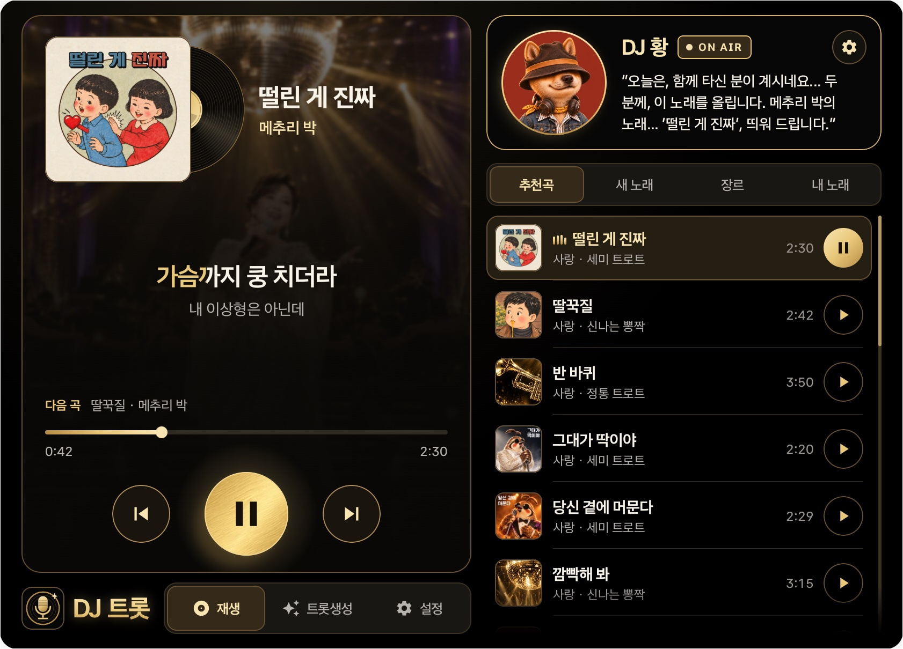
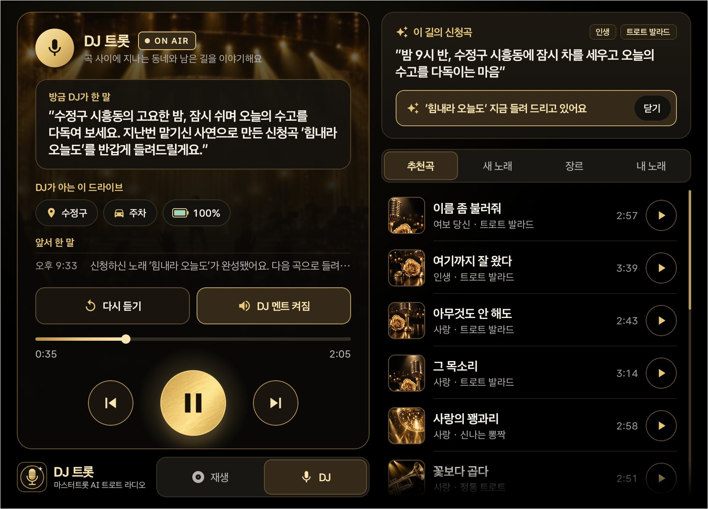
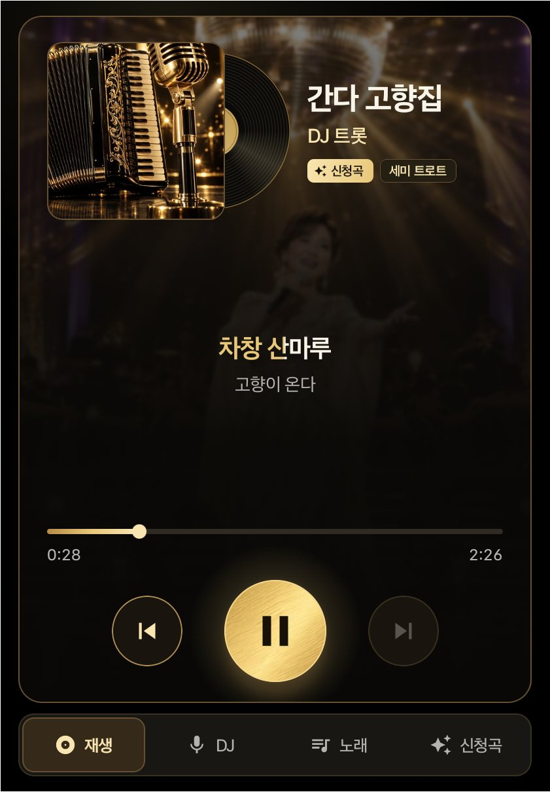
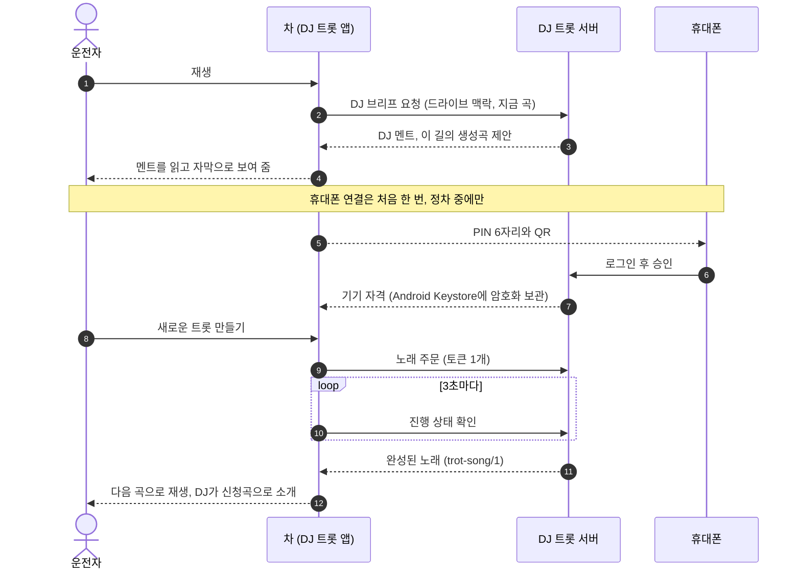

# DJ 트롯

**이 드라이브만을 위한 트로트를 AI가 만들어 틀어 주는, 차 안의 라디오 DJ.**

DJ 트롯은 현대자동차그룹 차량 인포테인먼트 [Pleos Connect](https://document.pleos.ai/)(Android Automotive OS 기반)에서 동작하는 음악 앱입니다. 차가 아는 목적지, 지나는 동네, 시간대, 주차·주행 상태로 DJ가 곡 사이에 이야기를 건네고, 운전자가 원하면 지금 이 길의 사연으로 새 트로트를 만들어 다음 곡으로 들려줍니다.

AI 트로트 서비스 **마스터트롯**의 차량용 앱이라, 휴대폰 연결은 마스터트롯 계정으로 합니다.

<p align="center">
  
</p>
<p align="center">
  
  
</p>
<p align="center"><sub>Pleos Connect Emulator 2.1.0에서 찍은 화면. 위는 넓은 창(두 칸), 아래 왼쪽은 DJ 칸, 오른쪽은 좁은 창(한 칸).</sub></p>

## 무엇을 하나요

- **곡 사이의 DJ**: 곡이 시작되면 DJ가 지금 상황에 맞춰 곡을 소개합니다. "부산역까지 42분 남았네요", "수정구 지나시는 밤길에"처럼 내비게이션과 차량 신호를 씁니다. 목소리는 서버가 미리 만든 DJ 음성(음성 팩)이 먼저이고, 그 음성이 없을 때만 기기 TTS(Pleos TextToSpeech)로 읽습니다.
- **트롯 제작실**: DJ가 이 드라이브에 어울리는 사연을 제안하고, 이야기·가락·목소리를 큰 버튼으로 고릅니다. 휴대폰을 연결하면 버튼 하나로 그 사연의 노래를 맡길 수 있습니다. 시연 모드에서는 연결 없이 바로 만듭니다.
- **제작 중계**: 맡긴 노래가 접수 → 작사 → 작곡 → 마무리로 넘어가는 과정을 DJ의 한마디와 함께 보여 줍니다. 가사가 나오면 제목과 몇 줄을 먼저 띄웁니다.
- **다음 곡으로 끼워 넣기**: 노래가 완성되면(보통 1~2분) 지금 곡 다음에 넣고 DJ가 알려 줍니다. 그 곡이 나올 때는 "아까 맡기신 사연으로 막 만든 신청곡"으로 소개합니다.
- **노래방 가사 자막**: 줄마다 시각이 맞춰진 가사를 무대에 띄웁니다.
- **주행 중에는 스스로 단순해지는 화면**: 달리는 동안에는 긴 글과 가사를 숨기고 재생 조작과 한 줄 안내만 남깁니다. 노래 목록은 반투명 잠금 막으로 덮고, "잠시 열기"를 누르면 20초 동안만 엽니다.

## 이렇게 동작합니다



서버에 닿지 못하면 DJ 멘트와 사연은 기기 안의 규칙(`dj/DjScript.kt`, `dj/StoryBuilder.kt`)으로 만들어 계속 진행합니다.

## 어떤 API를 어떻게 쓰나

DJ 트롯이 부르는 API는 세 갈래입니다. **Pleos Connect SDK**(차량·내비·음성), **AAOS 표준 API**(기어·충전·기온·주행 제한·미디어), **DJ 트롯 서버 API**(노래·멘트·DJ 목소리)입니다. 2026-11-15에 Pleos 공식 문서([document.pleos.ai](https://document.pleos.ai/))의 SDK 가이드·개발 가이드·심사 가이드와 SDK 2.3.2 / 3.0.5 / 3.3.1의 공개 API를 전부 대조해 정리했습니다.

### 한눈에

| 갈래 | 쓰는 것 | 맡은 일 | 코드 |
| --- | --- | --- | --- |
| Pleos Connect SDK | Vehicle, NaviHelper | 차가 아는 것(길·날씨·차의 상태)을 읽어 DJ 멘트의 재료로 | `car/CarSignals.kt` |
| Pleos Connect SDK | SpeechToText | 말로 넣는 사연 | `dj/StoryMic.kt` |
| Pleos Connect SDK | TextToSpeech | DJ 목소리의 **마지막 수단**(서버 음성이 없을 때만) | `dj/DjVoice.kt` |
| AAOS 표준 | CarUxRestrictions, CarPropertyManager | 주행 중 화면 제한, 기어, 충전, 바깥 기온 | `car/AaosCar.kt` |
| AAOS 표준 | Media3 MediaLibraryService, AudioManager | 재생, 시스템 미디어·스티어링 휠 연결, 오디오 포커스 | `playback/DjTrotLibraryService.kt` |
| DJ 트롯 서버 | REST(`/api/v1/dj-trot`) | 노래 목록·음원, DJ 멘트와 **DJ 목소리**, 노래 만들기, 광고, 휴대폰 연결 | `api/DjTrotApi.kt` |

### Pleos Connect SDK

Pleos Playground Maven 저장소에서 받습니다(`settings.gradle.kts`, 버전은 `gradle/libs.versions.toml`). 쓰는 도메인의 **읽기 권한만** 선언하고, 차를 제어하는(set) API는 하나도 쓰지 않습니다.

**Vehicle SDK 2.3.2** — `Vehicle(context).initialize()`로 붙고 도메인마다 `checkXXXCapabilities` → `registerXXX` 순서로 겁니다. 읽을 수 없다고 답한 값은 걸지 않고 화면의 차량 신호 표에 "지원 안 함"으로 보입니다. 서비스 연결이 끊겨 실패하면 5·10·20초 뒤 세 번까지 다시 붙습니다.

| 도메인 · API | 권한 | 이 앱에서 하는 일 |
| --- | --- | --- |
| `DrivingMode.registerDrivingModeState` · `getCurrentDrivingModeState` | `CAR_DRIVE` | 주행 모드. 스포츠 모드면 그 말을 하고, 서버에 가락을 고르는 재료로 보냄 |
| `DrivingMode.registerCruiseControlState` | `CAR_DRIVE` | 크루즈로 달리는 길의 멘트(`ACTIVATED`일 때만) |
| `Odometer.registerTripCurrentDrivingTime` · `getTripCurrentDrivingTime` | `CAR_DRIVE` | 시동 뒤 달린 시간. 두 시간이 넘으면 쉬어 가자고 함 |
| `EvBattery.registerEvBatteryStateOfCharge` · `getEvBatteryStateOfCharge` | `CAR_ENERGY` | 배터리 잔량. 15% 이하면 충전소에 들르자고 함 |
| `TurnSignal.registerTurnSignalState` | `CAR_LIGHTS` | 방향지시등이 켜진 동안 DJ가 말을 미룸 |
| `Light.registerFrontFogLightState` | `CAR_LIGHTS` | 앞 안개등이 켜지면 안개 낀 길의 인사 |
| `Wiper.registerWiperState(FRONT_WINDSHIELD)` | `CAR_WINDOWS` | 와이퍼가 20초 넘게 움직이면 비 오는 길로 봄 |
| `Seat.registerSeatOccupancy`(조수석·2열) | `CAR_SEATS` | 동승자가 있는지만. 기기 안에서만 쓰고 서버로 보내지 않음 |

폐기 예정으로 표시된 Vehicle API(`Gear`, `registerEvChargePortOpen`, `getEvBatteryLevel` 등)는 쓰지 않습니다. 같은 값은 아래 AAOS 표준 속성으로 읽습니다(Pleos SDK API 정책: 표준에 있으면 표준을 쓴다).

**NaviHelper SDK 3.0.5** — `initialize(onConnected, onFailed)`로 붙어 `addListener`로 이벤트를 받습니다. 권한은 조회용 `NAVI_ROUTE` 하나입니다. 목적지를 바꾸거나 경로를 요청하는 API(`requestRoute` 등, `NAVI_ROUTE_SEARCH`)는 쓰지 않습니다.

| 요청 · 이벤트 | 이 앱에서 하는 일 |
| --- | --- |
| `getCurrentLocationInfo` → `onCurrentLocationInfo` (15초마다) | 지금 주소(동네 이름)와 좌표. 좌표는 광고 장소를 **기기 안에서** 견주는 데만 씀 |
| `getDestinationInfo` → `onDestinationInfo` (15초마다, 경로가 바뀔 때) | 목적지 이름·주소·남은 시간. "부산역까지 42분" |
| `getRouteStateInfo` → `onRouteStateInfo` (15초마다) | 가는 길의 정체 시간·도로 이름, 사고(`ACCIDENT`), 공사(`REPAIRING`) |
| `getBookmarkInfo` → `onBookmarkInfo`, `onBookMarkChanged` | 목적지가 즐겨찾기의 집·회사인지. 기기 안에서만 씀 |
| `onRouteStarted`, `onWayPointArrived`, `onDestinationArrived`, `onRouteCancelled` | 출발·경유·도착 인사, 길 안내가 끝나면 목적지 값 비우기 |
| `onRoutingCompleted`, `onReRouteEnded`, `onDestinationChanged` | 목적지 다시 읽기 |
| `onNavigationStatus` | 목적지 없이 달리는 중(`FREE_DRIVE`)인지 |
| `onTBTInfo` | 300m 안의 회전이면 DJ가 말을 미룸. 1.5km 안의 터널·톨게이트·휴게소는 "곧"이라고 말함 |
| `onCautionPointInfo` | 300m 안이면 말을 미룸. 어린이보호구역(500m)에서는 곡 이름만. 1km 안의 안개 잦은 곳·미끄러운 길·야생동물·사고 잦은 곳은 미리 한마디 |
| `onCameraAlert` | 300m 안의 단속 카메라 안내 직전에 말을 미룸 |

**SpeechToText SDK 3.3.1** — 신청곡 카드의 마이크를 처음 누를 때 켭니다. `initialize` → `addListener` → `setLocale(Locale.KOREA)` → (서버 모드면 `registerApp`) → `request()`, 끝나면 `stop()`. `onUpdated(text, completed)`의 글을 사연으로 씁니다. 권한 `STT_SERVICE`. 음성 **명령**에는 쓰지 않습니다(그 용도는 Gleo Interface).

**TextToSpeech SDK 3.3.1** — `initialize` → `addEventListener` → `setLocale(Locale.KOREA)` → (서버 모드면 `registerApp`) → `speak(text, isFinal = true)` / `stop()`. 권한 `TTS_SERVICE`. 엔진이 실패하면 안드로이드 TTS로 바꿉니다. 로케일은 나라까지 붙은 `ko-KR`이어야 합니다(SDK가 `toLanguageTag()`로 보냅니다).

Client ID/Secret이 빌드에 있으면 TTS·STT는 `HYBRID`(서버 우선), 없으면 `ON_DEVICE` 모드입니다.

**쓰지 않는 것과 까닭**

| SDK · 기능 | 쓰지 않는 까닭 |
| --- | --- |
| FusedLocation SDK | 실행 중 위치 권한(`FUSED_LOCATION`)을 물어야 하고 차종별 지원이 다름. 필요한 위치는 내비가 주는 값으로 충분 |
| Gleo Interface(`assets/schema.json`) | 스키마 심사가 필요. 음성 검색은 Media3 표준 검색으로 열어 둠 |
| NaviHelper 경로 요청(`requestRoute`, `addWaypoint` …) | 권한 승인(`NAVI_ROUTE_SEARCH`)이 필요하고, 음악 앱이 목적지를 바꾸지 않음 |
| Vehicle 제어 API(`setXXX`), 그 밖의 도메인(HVAC, Door, Window, Safety …) | 음악 앱의 기능과 직접 관련이 없음(Pleos 보안 가이드: 필요한 API만) |
| LLM SDK | Pleos가 제공을 끝냄(2026-10-19) |

### AAOS 표준 API

| API | 권한 | 이 앱에서 하는 일 | 코드 |
| --- | --- | --- | --- |
| `CarUxRestrictionsManager` | 없음 | 주행 중 화면 제한 — 목록·사연·가사 숨김, 글 길이 제한, 휴대폰 연결 막기 | `car/AaosCar.kt`, `ui/Parts.kt` |
| `GEAR_SELECTION` | `CAR_POWERTRAIN` | 주차·주행 판단 | `car/AaosCar.kt` |
| `EV_CHARGE_PORT_OPEN`, `EV_CHARGE_PORT_CONNECTED` | `CAR_ENERGY_PORTS` | 서서 충전하는 동안의 멘트 | `car/AaosCar.kt` |
| `ENV_OUTSIDE_TEMPERATURE` | `CAR_EXTERIOR_ENVIRONMENT` | 0℃ 이하·30℃ 이상이면 날씨 한마디 | `car/AaosCar.kt` |
| Media3 `MediaLibraryService` + `MediaSession` | — | 재생, 브라우즈 트리, 검색, 스티어링 휠·시스템 미디어 연결 | `playback/DjTrotLibraryService.kt` |
| `AudioManager` 오디오 포커스 | — | 음악은 ExoPlayer가 관리. 음악 없이 멘트 조각만 틀 때는 그 소리의 포커스를 따로 받음 | `playback/DjTrotLibraryService.kt` |
| Android `TextToSpeech` | — | Pleos TTS가 안 될 때의 대체 | `dj/DjVoice.kt` |
| Android Keystore | — | 기기 자격 암호화 | `account/DeviceVault.kt` |

속성마다 `getCarPropertyConfig`로 이 차에 있는지 확인하고 겁니다. 없는 속성(전기차가 아닌 차의 충전구 등)은 그 값만 비웁니다.

### DJ 트롯 서버 API

기본 주소는 `djtrot.api`(운영 `https://miniapp.reopt.ai/api/v1/dj-trot`)입니다. 모양은 `api/Models.kt`, 호출은 `api/DjTrotApi.kt`에 있습니다.

| 경로 | 인증 | 이 앱에서 하는 일 |
| --- | --- | --- |
| `GET /config` | 선택 | 선택지 이름, DJ 목록과 준비 여부, 노래 만들기 열림·시연 모드, 서버가 받는 장면 목록(`scenes`) |
| `GET /catalog`, `/catalog/search?q=`, `/catalog/songs/{id}` | 없음 | 노래 선반, 검색, 곡 하나 |
| `POST /dj/brief` | 없음(있으면 붙임) | 곡이 시작될 때의 DJ 멘트 — 글, **음성 조각 주소**(`voiceClips`), 신청곡 제안 |
| `GET /dj/voice-pack?dj=` | 없음 | 그 DJ의 고정 멘트 조각 목록. 앱이 받아 두고 오프라인·출발·도착·광고·완성 알림에 씀 |
| `GET /dj/voice/{key}` | 없음 | 멘트 음성 한 조각(MP3) |
| `POST /pairings`, `/pairings/claim`, `/devices/session` | 없음 · 기기 자격 | 휴대폰 연결(PIN·QR)과 1시간 세션 |
| `GET /ads`, `POST /ads/{id}/played` | 없음 | 장소 광고의 조건과 음악, 재생 통계 |
| `GET /ads/progress`, `POST /ads/{id}/heard` | 세션 | 광고를 끝까지 들은 횟수와 생성권 |
| `GET /benefits` | 세션 | 남은 생성권 |
| `POST /songs`, `GET /songs`, `/songs/{id}`, `/songs/{id}/audio` | 세션 또는 시연 손님 ID | 노래 만들기, 내 노래 목록, 제작 중계, 음원 |

### 차가 아는 것 → DJ의 말

신호 하나가 멘트 하나가 됩니다. 급한 것부터 고르고(`dj/VoiceLines.kt`의 `scene`), 분위기 장면은 곡의 절반에만 씁니다.

| 차가 아는 것 | 어디서 | DJ의 말(조각 ID) |
| --- | --- | --- |
| 곧 휴게소·터널·톨게이트 | NaviHelper `onTBTInfo` | `scene.rest_area` · `tunnel` · `toll` |
| 안개 잦은 곳·미끄러운 길·야생동물·사고 잦은 곳 | NaviHelper `onCautionPointInfo` | `scene.caution_fog` · `caution_slippery` · `caution_wildlife` · `caution_accident` |
| 가는 길 사고·공사·정체 | NaviHelper `onRouteStateInfo` | `scene.accident` · `roadwork` · `jam` |
| 두 시간 넘게 운전 | Vehicle `Odometer` | `scene.long_drive` |
| 배터리 15% 이하 | Vehicle `EvBattery` | `scene.low_battery` |
| 서서 충전 | AAOS 충전구·충전기 + 기어 | `scene.charging` |
| 동승자(기기 안에서만) | Vehicle `Seat` | `scene.company` |
| 바깥 0℃ 이하·30℃ 이상 | AAOS `ENV_OUTSIDE_TEMPERATURE` | `scene.cold` · `hot` |
| 스포츠 모드 | Vehicle `DrivingMode` | `scene.sport` |
| 크루즈 주행 | Vehicle `DrivingMode` | `scene.cruising` |
| 목적지 없이 달림 | NaviHelper `onNavigationStatus` | `scene.free_drive` |
| 비·안개 | Vehicle `Wiper` · `Light` | `open.rain` · `open.fog` |
| 시간대 | 기기 시계 | `open.dawn` … `open.night` |
| 목적지와 남은 시간(집·회사는 기기 안에서만) | NaviHelper `onDestinationInfo` · 즐겨찾기 | `eta.{home|office|place}.{분}` |
| 출발·경유·도착 | NaviHelper 이벤트 | `depart.*` · `waypoint` · `arrive.*` |
| 어린이보호구역 | NaviHelper `onCautionPointInfo` | 곡 이름만 말함 |
| 회전·주의 구간·카메라 300m 앞, 방향지시등 | NaviHelper · Vehicle `TurnSignal` | 말을 미룸(15초 넘으면 생략) |
| 맡긴 노래 완성 | 서버 `GET /songs/{id}` | `song.ready` |
| 광고를 끝까지 들음 | 서버 `POST /ads/{id}/heard` | `ad.outro.{1|2|granted|capped|limited}` |

### DJ 목소리가 나오는 순서

DJ의 말은 **서버가 만든 음성**이 먼저이고, 기기 TTS는 그 음성이 하나도 없을 때만 씁니다(`DjTrotLibraryService.announce`·`talk`).

1. 서버 브리프(`POST /dj/brief`)가 준 음성 조각. 이미 받아 둔 조각은 파일로 틉니다.
2. 브리프가 음성을 주지 못하면(늦음, 오프라인, 서버의 음성 팩이 꺼짐) **받아 둔 음성 팩**에서 같은 규칙으로 고른 조각.
3. 서버가 통문장 음성만 주고 그 문장이 곡을 말하지 않으면, 그 음성 뒤에 받아 둔 곡 소개 조각을 이어 붙임.
4. 위의 음성이 하나도 없을 때만 기기 TTS(Pleos TextToSpeech → 안드로이드 TTS)가 글을 읽음.

광고·생성권 알림은 받아 둔 조각이 있을 때만 소리로 내고, 없으면 글로만 알립니다. 새로 더한 장면의 조각을 아직 받지 못했으면 시간대·날씨 인사로 대신합니다(서버도 같은 식으로 고릅니다).

음성 앞에는 0.18초의 묵음을 두고(첫 음절이 잘리지 않게), 조각 사이에는 0.35초 숨을 넣습니다.

### 쓰지 않으면 내려놓기

- **차량 신호**: 화면이 보이는 동안과 재생 서비스가 사는 동안만 듣습니다(`CarSignals.hold`·`release`). 둘 다 놓고 10초가 지나면 리스너를 풀고 SDK 연결을 놓습니다.
- **재생 서비스**: 노래가 나오지 않은 채 5분(끝났거나 아직 틀지 않았으면 1분)이 지나면 재생기를 멈춰 오디오 포커스를 돌려주고 Started 상태를 풉니다. 화면도 떠나 있으면 프로세스는 cached 상태가 됩니다(Pleos 미사용 앱 BG→CCH 전환 가이드). 에뮬레이터에서 `dumpsys activity lru`로 확인했습니다.

SDK마다 따로 실패할 수 있어서(차종, 에뮬레이터, 권한) 하나가 안 되면 그 값만 비우고 나머지로 동작합니다. 즐겨찾기(집·회사), 동승자 유무, 좌표는 기기 밖으로 나가지 않습니다.

## Pleos 음악 앱 요건

[Pleos Music/Audio 개발 가이드](https://document.pleos.ai/en/docs/pleos-only/vehicle-app-developer-guide/music-audio-app-developement-guide)의 요건과 이 앱의 대응입니다. 요건 원문 정리는 [docs/contest.md](docs/contest.md)에 있습니다.

| 요건 | 대응 |
| --- | --- |
| `appCategory="audio"`, 런처 노출 | `AndroidManifest.xml`에 `appCategory`와 `androidx.car.app.launchable` 선언 |
| MediaLibraryService + MediaSession | `DjTrotLibraryService`가 재생, 브라우즈 트리(추천·새 노래·장르·내 노래), 검색을 제공 |
| 스티어링 휠 제어 | MediaSession 표준 명령으로 재생·일시정지·이전·다음 |
| 음성 검색 | Media3 표준 `onSearch`, `onGetSearchResult`, 검색어로 재생(`onAddMediaItems`). Gleo가 이 방식으로 붙는 기능은 Pleos가 준비 중이라 지금은 미디어 센터 검색에 쓰임([알려진 제한](#알려진-제한)) |
| 오디오 포커스 | ExoPlayer가 포커스를 관리하고, 영구 손실이면 재생을 멈춰 포커스를 돌려줌. 일시 손실(Gleo, 통화)이나 사용자 정지에는 DJ 목소리도 바로 멈춤 |
| 자동 재생 금지 | 서비스가 뜨거나 연결돼도 재생하지 않음. 시스템 재개 요청에는 목록만 준비 |
| 서비스 수명 | `onCreate`에서 started 상태, 재생 중 포그라운드, `onTaskRemoved`에서 정지 후 `stopSelf` |
| 미사용 앱 BG→CCH | 노래가 나오지 않은 채 5분(끝났거나 틀기 전이면 1분)이면 재생기를 멈춰 포커스를 돌려주고 `stopSelf`. 차량 신호 리스너도 함께 풉니다 |
| 음성 안내 선행 묵음 | DJ 음성 조각 앞에 0.18초 묵음을 데이터 단계에서 넣음. 기기 TTS는 음악을 먼저 줄이고 0.4초 뒤에 말함 |
| 재생 전 오디오 포커스 | 음악은 ExoPlayer가, 음악 없이 트는 멘트 조각은 그 소리의 포커스를 따로 받음. 받지 못하면 틀지 않음 |
| 주행 제한 | `distractionOptimized` 화면이 CarUxRestrictions를 따라 목록·사연 본문·가사를 숨기고 멘트를 한 줄로 줄임. 글 길이 제한(`LIMIT_STRING_LENGTH`)과 설정 금지(`NO_SETUP`) 항목도 반영 |
| 휴대폰 로그인 | 정차 전용 화면(`ConnectActivity`)에서 PIN과 QR로. 주행 중에는 시스템이 막음 |
| 회전 조작기(CCP) | 지원하지 않는다고 선언하고 모든 조작을 터치로 끝낼 수 있게 둠 |

화면은 Pleos Connect UI Design Guide를 따릅니다. 글자 크기는 Pleos 단계(`DjType`)만 쓰고, 글자 대비는 4.5:1 이상을 지킵니다. 창이 두 칸(가로)이면 무대와 목록 2열, 한 칸(세로)이면 1열에 아래 탭 네 개 [재생 · DJ · 노래 · 신청곡]으로 다시 배치합니다.

## 차가 서버로 보내는 것

DJ 멘트와 신청곡 제안을 위해 아래 값만 보냅니다(`api/Models.kt`의 `DriveInput`).

| 보내는 값 | 예 |
| --- | --- |
| 목적지 이름·주소, 남은 시간(분) | 부산역, 42 |
| 현재 주소(동 단위)와 지역 이름 | 경기도 성남시 수정구 시흥동, 성남 |
| 현지 시각 | 21:30 |
| 말로 넣은 사연(음성 입력 전까지는 빈 문자열) | "" |
| 주행 모드, 기어, 달리는 중인지 | NORMAL, PARK, false |
| 날씨(비·안개)와 길 위의 장면 하나 | rain, tunnel |
| 지금 트는 곡 제목·가수, 내가 만든 노래면 그 노래의 ID | 힘내라 오늘도 |

**DJ 브리프 요청에는 위치 좌표와 차량·계정 식별 정보가 들어가지 않습니다.** 서버가 모르는 키를 받으면 요청을 거절하므로, 값이 null인 키는 보내지 않는다는 점까지 단위 테스트(`ContractTest`)로 지킵니다.

## 시작하기

### 준비물

| 도구 | 버전 |
| --- | --- |
| JDK | 17 |
| Android SDK | compileSdk 37, targetSdk 34, minSdk 28 |
| Gradle | 저장소의 wrapper(9.8.2), AGP 9.4.1, Kotlin 2.4.21 |
| 에뮬레이터 | Pleos Connect Emulator 2.1.0(Android 14 Automotive, arm64) |

Pleos SDK는 Pleos Playground Maven 저장소에서 받습니다(`settings.gradle.kts`에 등록돼 있습니다).

### 빌드와 실행

```bash
export JAVA_HOME=/path/to/jdk-17
./gradlew :app:testDebugUnitTest       # 단위 테스트
./gradlew :app:installDebug            # 연결된 에뮬레이터에 설치
adb shell am start -n ai.reopt.djtrot/.ui.MainActivity
```

서버 주소는 기본으로 운영 서버를 봅니다. 다른 서버를 쓰려면 빌드할 때 넘깁니다. 에뮬레이터에서 `10.0.2.2`는 개발 PC의 `127.0.0.1`입니다.

```bash
./gradlew :app:installDebug -Pdjtrot.api=http://10.0.2.2:8787/api/v1/dj-trot
```

### Pleos TTS·STT 서버 모드(선택)

Pleos Playground 프로젝트의 Client ID/Secret이 있으면 TTS와 STT가 서버 우선(하이브리드) 모드로 동작합니다. 없으면 온디바이스 모드로만 말합니다. 값은 저장소가 아니라 사용자 Gradle 설정에 둡니다.

```properties
# ~/.gradle/gradle.properties
djtrot.pleosClientId=...
djtrot.pleosClientSecret=...
```

### Pleos Connect Emulator 설치(명령줄)

Android Studio 없이 설치하는 방법입니다. 공식 안내는 [Pleos 문서](https://document.pleos.ai/docs/connect/guide/getting-started/application-development/setup-connect-sdk-emulator)를 보세요.

1. 이미지: `https://nexus-playground.pleos.ai/repository/raw-releases/connect-avd/2.x/crp-arm64-sys-img.xml`에 적힌 `crp_car_arm64_emulator.zip`(약 4.7GB, 풀면 19GB). 받으면 42dot SDK 라이선스에 동의한 것으로 봅니다.
2. `$ANDROID_HOME/system-images/android-34/android-automotive/arm64-v8a/`에 풉니다. 이미지 태그가 `android-automotive`라서 다른 경로에 두면 avdmanager가 받지 않습니다.
3. AVD를 만듭니다.
   ```bash
   avdmanager create avd -n DJTrot_Pleos_API34 \
     -k "system-images;android-34;android-automotive;arm64-v8a" -d Pleos_Connect_v2_0
   ```
   `~/.android/avd/DJTrot_Pleos_API34.avd/config.ini`에 `hw.ramSize=4096`, `fastboot.forceColdBoot=yes`를 넣습니다. 빠른 부팅으로 켜면 차량 속성(VHAL)을 쓰지 못합니다.
4. 실행합니다.
   ```bash
   emulator -avd DJTrot_Pleos_API34 -no-snapshot-load -no-snapshot-save -gpu host
   ```

### 에뮬레이터에서 시험하는 요령

- **차량 값 바꾸기**: `adb forward tcp:8088 tcp:8088` 후 브라우저에서 `http://127.0.0.1:8088/`(Virtual Console)을 엽니다. 기어를 D로, 속도를 올리면 주행 중 화면을 볼 수 있습니다. 콘솔은 브라우저 세션이 살아 있을 때만 값을 받습니다.
- **시간대**: 에뮬레이터 기본 시간대는 `America/Los_Angeles`라 DJ가 말하는 시각이 어긋납니다. `adb shell service call alarm 3 s16 Asia/Seoul`로 바꿉니다.
- **좁은 창 보기**: `adb shell am task resize <taskId> 853 90 1694 1300`(한 칸), `… 853 90 2535 1300`(두 칸). taskId는 `adb shell dumpsys activity activities`의 DJ 트롯 Task 번호입니다.
- **뒤로 키**: adb로 보내는 뒤로 키는 입력 포커스가 있는 창이 받습니다. 앱 화면을 한 번 누른 뒤 보냅니다.
- **권한**: 앱이 쓰는 Pleos 권한은 모두 선언만으로 받습니다. 실행 중에 묻는 권한은 없습니다.
- **안내 직전 미루기 보기**: Virtual Console에서 방향지시등을 켜면 DJ 멘트가 화면에 먼저 뜨고, 끄면 목소리가 나옵니다.
- **앱 창 크기**: 앱 창은 왼쪽 클러스터 옆 1682×1210dp(mdpi) 멀티 윈도우입니다. 화면은 이 크기를 기준으로 그리고 창에 맞춰 비율을 조정합니다.

### 목 서버로 시험하기

`tools/mock_djtrot.py`는 개발용 목 서버입니다. 제공 목록은 마스터트롯 공개 무대 API(`--stage`)의 곡과 가사 시각으로 만들고, 음원은 `--audio-dir`의 MP3로 대신합니다. 나머지 요청은 `--upstream`의 DJ 트롯 서버로 넘깁니다. 파이썬 표준 라이브러리만 씁니다.

```bash
uv run --no-project tools/mock_djtrot.py --audio-dir ~/Music/trot --upstream http://127.0.0.1:8787
./gradlew :app:installDebug -Pdjtrot.api=http://10.0.2.2:8790/api/v1/dj-trot
```

`--fake-songs 45`를 더하면 노래 만들기 요청을 서버로 보내지 않고, 45초 동안 만드는 중으로 답한 뒤 이 계정이 이미 만든 노래로 완성합니다. 노래 만들기는 토큰과 서버 비용이 드니, 화면 확인과 시연 연습은 이 모드로 합니다.

### 차량 신호 흉내 내기

화면 아래 탭의 **설정**에는 자동 시연(정해 둔 길을 차례로 보여 줌), 시뮬레이션, DJ 멘트 살펴보기, 차량 신호(지금 받는 값을 SDK별로 표시), DJ 설정(멘트 켜기·길게 말하는 간격·멘트 중 음악 크기), 연결·계정, 앱 정보가 있습니다. **설정 › 시뮬레이션**에서도 같은 상황을 버튼으로 흉내 낼 수 있습니다(출발, 비·안개·정체·터널·휴게소·동승자 같은 길 위의 장면, 공사·주의 구간·배터리 부족·추위·더위·스포츠 모드, 시간대, 경유·도착·충전). 노래가 나오는 중에 누르면 DJ가 지금 곡 위에서 그 상황으로 다시 말합니다. "실제 신호로"를 누르면 덧씌운 값이 지워집니다. 심사·전시처럼 차가 서 있는 자리에서 쓰는 기능이고, `-Pdjtrot.demo=false`로 빌드하면 탭이 없습니다.

에뮬레이터는 정체, 터널·휴게소, 와이퍼, 동승자, 달린 시간 같은 값을 주지 않고 마이크 인식도 되지 않습니다. `tools/trigger.py`는 디버그 빌드에만 있는 수신기에 adb 브로드캐스트를 보내 이 신호를 실제 값 위에 덧씌우고, 그 신호로 기기 DJ가 할 말과 서버로 가는 맥락을 찍어 줍니다. 파이썬 표준 라이브러리와 adb만 씁니다.

```bash
uv run --no-project tools/trigger.py keys                                   # 쓸 수 있는 키와 시나리오
uv run --no-project tools/trigger.py set gear=DRIVE rain=on jam=12 --next   # 신호를 덧씌우고 다음 곡으로 넘겨, DJ가 실제로 한 말을 찍는다
uv run --no-project tools/trigger.py depart 강릉역 --min 150 --km 210       # 길 안내 시작(waypoint, arrive도 같은 모양)
uv run --no-project tools/trigger.py say "어머니 생신이라 고향 가는 길이에요"  # 마이크 대신 말로 넣는 사연
uv run --no-project tools/trigger.py scenario trip --step 20 --next         # 정해 둔 길(trip, home, wander)을 차례로
uv run --no-project tools/trigger.py watch                                  # DJ가 실제로 하는 말을 나오는 대로
uv run --no-project tools/trigger.py clear                                  # 모두 실제 값으로
```

결과에는 지금 신호로 번갈아 나올 곡 소개 두 가지, 뒤로 밀려 나오지 않는 말, 재생 상태, DJ가 실제로 마지막에 한 말이 함께 찍힙니다.

- 곡 소개 멘트는 곡이 바뀔 때 나옵니다. 출발·경유지·도착 한마디는 노래가 나오는 중이고 DJ 멘트가 켜져 있을 때만 나오고, 아니면 결과에 ⚠️로 알립니다. 첫 재생은 화면의 시작 버튼으로 켭니다(자동 재생 금지).
- 서버가 닿으면 서버 DJ 브리프가 먼저입니다. 기기 멘트를 들으려면 서버가 닿지 않게 하고(목 서버를 끄거나 없는 주소로 설치) 시험합니다.
- 덧씌운 값은 앱 프로세스가 끝나면 사라집니다. `say`는 앱이 평소 하듯 DJ 브리프를 한 번 부르고, 노래 만들기는 부르지 않습니다.

## 테스트

```bash
./gradlew :app:testDebugUnitTest   # JVM 단위 테스트
./gradlew :app:lintDebug            # Android lint. 경고가 하나라도 있으면 실패
```

GitHub Actions 워크플로(`.github/workflows/ci.yml`)가 단위 테스트, lint, 디버그 빌드, 목 서버 검사, 커밋 메시지 검사를 한 번에 돌립니다. 인프라 비용을 줄이려고 자동 실행은 꺼 두었고, 필요할 때 Actions 탭에서 수동으로 돌립니다. 평소에는 아래 명령으로 같은 검사를 로컬에서 합니다. `CI=true`를 주면 CI처럼 Kotlin 컴파일 경고도 실패로 봅니다.

```bash
CI=true ./gradlew :app:testDebugUnitTest :app:lintDebug :app:assembleDebug
```

lint에서 일부러 남기는 항목은 `app/lint.xml`에 이유와 함께 적습니다.

JVM 단위 테스트가 차량·서버 없이 도는 규칙을 검사합니다.

| 테스트 | 검사하는 것 |
| --- | --- |
| `ContractTest` | 서버와 주고받는 JSON 모양, 보내지 않아야 할 키, 기어로 주행 여부 판단, 음원 주소와 토큰 |
| `DriveContextTest`, `RegionTest` | 주행 중 제한 항목(글 길이, 설정 금지) 읽기, 주소에서 지역 이름 뽑기 |
| `DjScriptTest`, `JosaTest`, `StoryBuilderTest` | 오프라인 DJ 멘트, 조사(으로/로) 붙이기, 기기에서 짓는 사연 |
| `DjStateTest` | 앞서 한 말 기록, 신청곡 제안이 오래되면 버리기 |
| `ArtTest`, `LyricTimelineTest` | 장르별 그림과 곡마다 다른 표지, 재생 시각에 맞는 가사 줄 |

화면 동작(창 크기, 주행 중 제한, 노래 만들기 흐름)은 Pleos Connect Emulator에서 확인합니다.

## 프로젝트 구조

```
app/src/main/java/ai/reopt/djtrot/
├── DjTrotApp.kt     앱 전역 상태: 차량 신호, 계정, 재생 목록, DJ 상태
├── api/             DJ 트롯 서버 클라이언트(DjTrotApi)와 주고받는 모델(trot-song/1 등)
├── account/         휴대폰 연결: 기기 자격 암호화 보관(DeviceVault), 1시간 세션(DeviceAccount)
├── car/             차량 신호: Pleos SDK와 AAOS Car API(CarSignals, AaosCar), 주행 맥락(DriveContext)
├── dj/              DJ: 목소리(DjVoice), 노래 주문(SongOrders), 오프라인 멘트·사연(DjScript, StoryBuilder)
├── playback/        재생: Media3 서비스(DjTrotLibraryService), 브라우즈 트리·검색·큐(Catalog)
└── ui/              화면: 무대(DjScreen), 신청곡·노래 목록(Shelf), 휴대폰 연결(ConnectActivity), 공통 부품
app/src/debug/       디버그 빌드에만 들어가는 것: 평문 HTTP 허용, 차량 신호 시험 수신기(debug/)
app/src/test/        JVM 단위 테스트(디버그 전용 코드는 app/src/testDebug/)
tools/mock_djtrot.py 개발용 목 서버
tools/trigger.py     차량 신호 시험 도구
docs/                구조 설명, 공모전·Pleos 요건 정리, README 이미지
.github/             CI(수동 실행), Dependabot, 이슈·PR 템플릿
```

상태가 어디에 있고 곡이 바뀔 때 무슨 일이 일어나는지, 왜 그렇게 짰는지는 [docs/architecture.md](docs/architecture.md)에 있습니다.

## 알려진 제한

- **운영 서버 준비 중**: 기본 빌드가 보는 운영 서버 주소는 아직 열리지 않았습니다(2026-10). 그동안은 `-Pdjtrot.api`로 개발 서버를 지정합니다.
- **기기 TTS(에뮬레이터)**: 서버의 DJ 음성 팩이 켜져 있으면 DJ는 그 음성으로 말하고 기기 TTS는 쓰이지 않습니다. 음성 팩이 없을 때 쓰는 Pleos TTS 온디바이스 엔진은 에뮬레이터에서 `ON_DEVICE_ENGINE_ERROR`를 낸 적이 있습니다. 2026-11-15에 로케일을 `ko-KR`로 바로잡았지만(그전에는 `ko`를 보냈습니다) 소리가 나는지는 다시 확인하지 않았습니다. Client ID/Secret을 넣으면 서버 모드로 말합니다.
- **새 멘트는 음성 팩을 다시 만들어야 소리로 나옴**: 2026-11-15에 더한 장면(공사, 주의 구간 넷, 배터리 부족, 추위·더위, 스포츠 모드)과 노래 완성·광고 하루 상한 알림은 서버가 그 조각을 만들어 둔 뒤부터 DJ 목소리로 나옵니다. 그전에는 시간대·날씨 인사로 대신하고, 알림은 글로만 보입니다.
- **Pleos TTS와 음악의 오디오 포커스는 실차 확인 전**: Pleos 음성 서비스가 말할 때 포커스를 어떻게 청하는지 문서에 없습니다. 음악이 일시 손실을 받으면 앱은 DJ 목소리도 함께 멈춥니다.
- **주행 모드 값 없음(에뮬레이터)**: 에뮬레이터가 DrivingMode 속성을 지원하지 않아 화면에서 생략합니다.
- **말로 사연 넣기(에뮬레이터)**: Pleos SpeechToText로 듣습니다. 에뮬레이터에서는 맥의 마이크를 에뮬레이터에 열어 줘야 하고, 온디바이스 엔진이 없으면 Client ID/Secret을 넣은 서버 모드로만 듣습니다. 듣지 못하면 카드에 까닭을 보이고 사연은 그대로 둡니다.
- **새 차량 신호는 실차 확인 전**: 정체, 터널·톨게이트·휴게소, 주의 구간, 달린 시간, 크루즈, 안개등, 와이퍼, 좌석, 충전구·충전기, 바깥 기온은 차종과 내비 구현에 따라 값이 오지 않을 수 있습니다. 오지 않으면 그 멘트만 나오지 않습니다.
- **Gleo 음성 명령은 아직 없음**: Pleos 문서상 Media3 검색만으로 Gleo에 붙는 방식은 준비 중입니다. 지금 Gleo에 기능을 내주려면 Gleo Interface(`assets/schema.json`)를 선언하고 42dot 승인을 받아야 합니다.
- **내비 안내 이벤트(에뮬레이터)**: 안내 직전 미루기는 내비가 TBT·주의 구간·카메라 이벤트를 보낼 때만 동작합니다. 어떤 이벤트를 보내는지는 내비 구현마다 다릅니다(Pleos NaviHelper 문서).
- **홈 화면 미디어 위젯**: Pleos Media Center 템플릿을 쓴 앱만 홈 위젯과 시스템 미디어 목록에 자동으로 올라갑니다. DJ 트롯은 자체 화면을 쓰므로 런처와 독에서 엽니다.

## 공모전 제출물

[현대자동차그룹 차량용 앱 개발 공모전](https://appdevchallenge.auto-hmg.io/) 출품작입니다.

- 실행 방법과 테스트 환경: 위의 [시작하기](#시작하기)
- 제출용 APK: `apk/` 폴더(`apk/팀명_앱이름_release.apk` 형식, 제출 때 올림)
- 공모전 일정과 요건: [docs/contest.md](docs/contest.md)

## 기여

작업 방식, 커밋 메시지 규칙, 저장소에 넣지 않는 것은 [CONTRIBUTING.md](CONTRIBUTING.md)에 있습니다. 처음 한 번 커밋 메시지 검사를 켜 주세요.

```bash
git config core.hooksPath .githooks
```

보안 문제를 알리는 방법과 비밀값이 새었을 때 할 일은 [SECURITY.md](SECURITY.md)에 있습니다.

## 라이선스

비공개 저장소입니다. 코드와 이미지의 권리는 reopt Inc.에 있으며, 허락 없이 복제하거나 배포할 수 없습니다. Pleos SDK와 Pleos Connect Emulator 이미지는 42dot의 라이선스를 따릅니다. 화면 아이콘 일부는 Google [Material Symbols](https://github.com/google/material-design-icons)(Apache License 2.0)의 도형을 옮겨 썼습니다.
