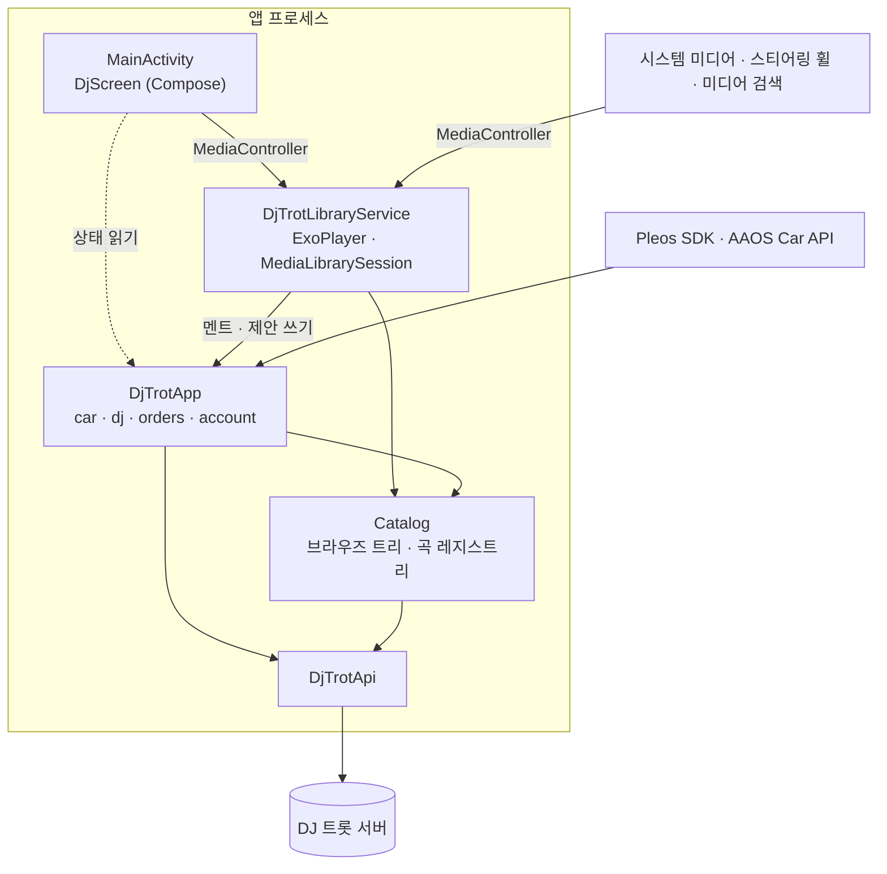
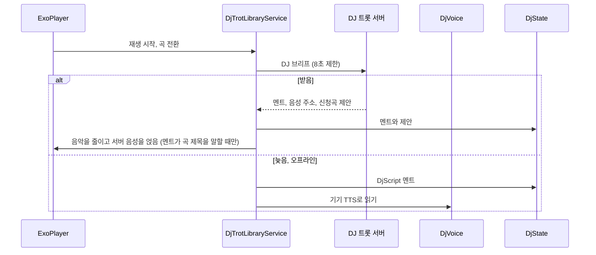
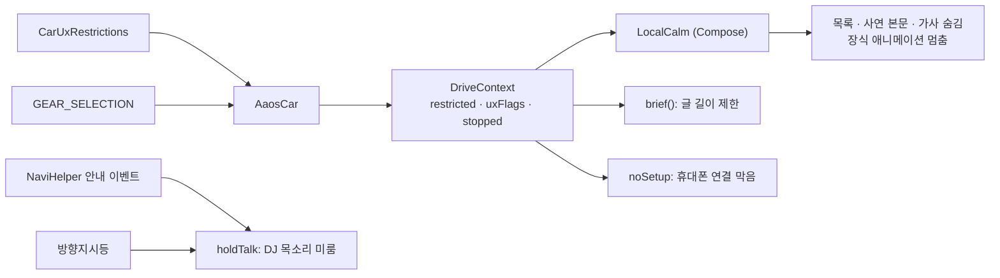

# 구조

DJ 트롯 차량 앱이 어떻게 짜여 있고 왜 그렇게 짰는지 정리합니다. 무엇을 하는 앱인지는 [README](../README.md)를 먼저 봐 주세요.

## 한눈에

모듈은 `:app` 하나이고 프로세스도 하나입니다. 화면과 재생 서비스는 `DjTrotApp`이 만든 객체를 함께 씁니다.

| 패키지 | 맡은 일 |
| --- | --- |
| `api/` | 서버 클라이언트(`DjTrotApi`)와 주고받는 모델(`Models.kt`) |
| `account/` | 휴대폰 페어링으로 받은 기기 자격 보관(`DeviceVault`)과 1시간 세션(`DeviceAccount`) |
| `car/` | 차량 신호를 모아 `DriveContext` 하나로(`CarSignals`, `AaosCar`) |
| `dj/` | 멘트 템플릿(`DjScript`), 기기에서 짓는 사연(`StoryBuilder`), 목소리(`DjVoice`), 노래 주문(`SongOrders`) |
| `playback/` | 재생 서비스(`DjTrotLibraryService`)와 브라우즈 트리·검색·큐(`Catalog`) |
| `ui/` | 화면. 무대(`DjScreen`), 목록과 신청곡(`Shelf`), 휴대폰 연결(`ConnectActivity`), 공통 부품과 테마 |

## 상태는 어디에 있나

| 상태 | 주인 | 쓰는 쪽 | 읽는 쪽 |
| --- | --- | --- | --- |
| 차량 신호 `StateFlow<DriveContext>` | `CarSignals` | Pleos SDK와 AAOS 콜백 | 화면, 서비스(멘트 재료) |
| DJ 상태 `MutableStateFlow<DjState>` | `DjTrotApp.dj` | 서비스(멘트, 신청곡 제안, 재생 문제) | 화면 |
| 노래 주문 `current`, 토큰 `tokens` | `SongOrders` | 화면의 "노래 만들기" | 화면, 서비스(`ready`를 받아 큐에 넣음) |
| 연결 상태 `connection` | `DeviceAccount` | 페어링, 세션 갱신, 401 | 화면, `Catalog`(내 노래 폴더) |
| 재생 상태 | 서비스의 ExoPlayer | 화면·스티어링 휠·음성의 MediaController | 화면(`rememberPlayerUi`) |

차량 신호는 화면이나 서비스 중 먼저 뜬 쪽이 `car.start()`로 켜고, 프로세스가 살아 있는 동안 유지합니다. 곡 정보는 `MediaItem`의 `MediaMetadata.extras`(`djtrot.*` 키)에 실려 서비스와 화면, 시스템 미디어가 같은 값을 봅니다.

## 곡이 바뀔 때

- 멘트는 곡이 실제로 울리기 시작할 때 한 번만 냅니다. 오래 멈췄다 같은 곡을 이어 틀면 신청곡 제안만 새로 받습니다.
- 서버 음성이 곡 제목을 말하지 않으면 기기 TTS로 읽습니다. 두 목소리가 섞이지 않게 하려는 것입니다.
- 음원을 받지 못한 곡은 건너뛰고, 세 곡 연속 실패하면 멈추고 화면에 알립니다.

## 노래 주문

`SongOrders`가 앱 범위 코루틴에서 `POST /songs`를 보내고 5초마다 상태를 확인합니다. 응답을 받지 못하고 실패한 주문을 다시 누르면 같은 `requestKey`를 보내서, 첫 요청이 서버에 닿았더라도 한 곡만 만들어집니다. 완성되면 `Catalog.register()`로 "내 드라이브 노래"에 넣고 `ready`로 내보냅니다. 서비스가 그 곡을 지금 곡 다음에 넣고 DJ가 알립니다. 화면을 닫아도 주문은 끝까지 지켜봅니다. 전체 흐름은 README의 순서도에 있습니다.

## 주행 중 제한

`DjScreen`은 `!stopped || restricted`이면 주행 중으로 보고 `LocalCalm`을 켭니다. 아래 부품은 이 값만 보고 스스로 줄어듭니다. 새 부품도 같은 값을 따라야 합니다. 판단 규칙(`DriveContext`)은 안드로이드에 의존하지 않아 JVM 테스트로 검사합니다.

DJ 목소리는 화면과 따로 미룹니다. 내비가 300m 안의 회전, 주의 구간, 단속 카메라를 알리거나 방향지시등이 켜지면 `holdTalk`가 참이 됩니다. 멘트는 화면에 먼저 뜨고, 목소리는 풀리고 1.5초 쉰 뒤에 나옵니다. 15초를 넘게 기다리면 읽지 않습니다. 기기 TTS로 읽을 때는 음악을 0.3초에 걸쳐 먼저 줄이고 0.4초 뒤에 입을 뗍니다.

## 설계 결정

- **DI 프레임워크 없이 `Application`의 lazy 객체로.** 객체 그래프가 한 단계라 프레임워크가 주는 이득보다 비용이 큽니다. 테스트하는 규칙은 순수 함수와 데이터 클래스로 빼 둡니다.
- **재생과 DJ를 서비스에 둠.** 화면이 닫혀도, 다른 앱이 앞에 있어도 곡 소개와 완성 알림이 나와야 합니다. 스티어링 휠과 시스템 미디어도 같은 세션에 붙습니다.
- **서버 없이도 이어지게.** DJ 멘트와 신청곡 사연은 서버가 늦거나 닿지 않으면 기기 규칙으로 만듭니다. 운전 중에 빈 화면이나 침묵을 만들지 않으려는 것입니다.
- **보낼 때는 엄격하게.** 서버는 모르는 키가 든 요청을 거절합니다. 앱은 null인 키를 보내지 않고(`explicitNulls = false`), 받을 때는 모르는 키를 무시합니다. 모양은 `ContractTest`가 지킵니다.
- **기준 창에 맞춰 비례 조정.** Pleos 앱 창은 두 칸(1682×1210dp)과 한 칸(그 절반 폭) 두 가지입니다. 각 기준 크기로 그린 뒤 `LocalDensity`로 실제 창에 맞춥니다. 두 칸을 그대로 줄이지 않고 한 칸에서는 탭 배치로 다시 짭니다.

## 테스트의 경계

| 대상 | 방법 |
| --- | --- |
| 서버 계약, 주행 판단, 멘트·사연, 가사 시각, 표지 고르기 | JVM 단위 테스트(`app/src/test`) |
| 재생 서비스, Pleos SDK, 창 크기, 주행 중 화면 | Pleos Connect Emulator에서 확인 |
| 서버 쪽 동작(노래 만들기 흐름) | 목 서버 `tools/mock_djtrot.py --fake-songs` |
