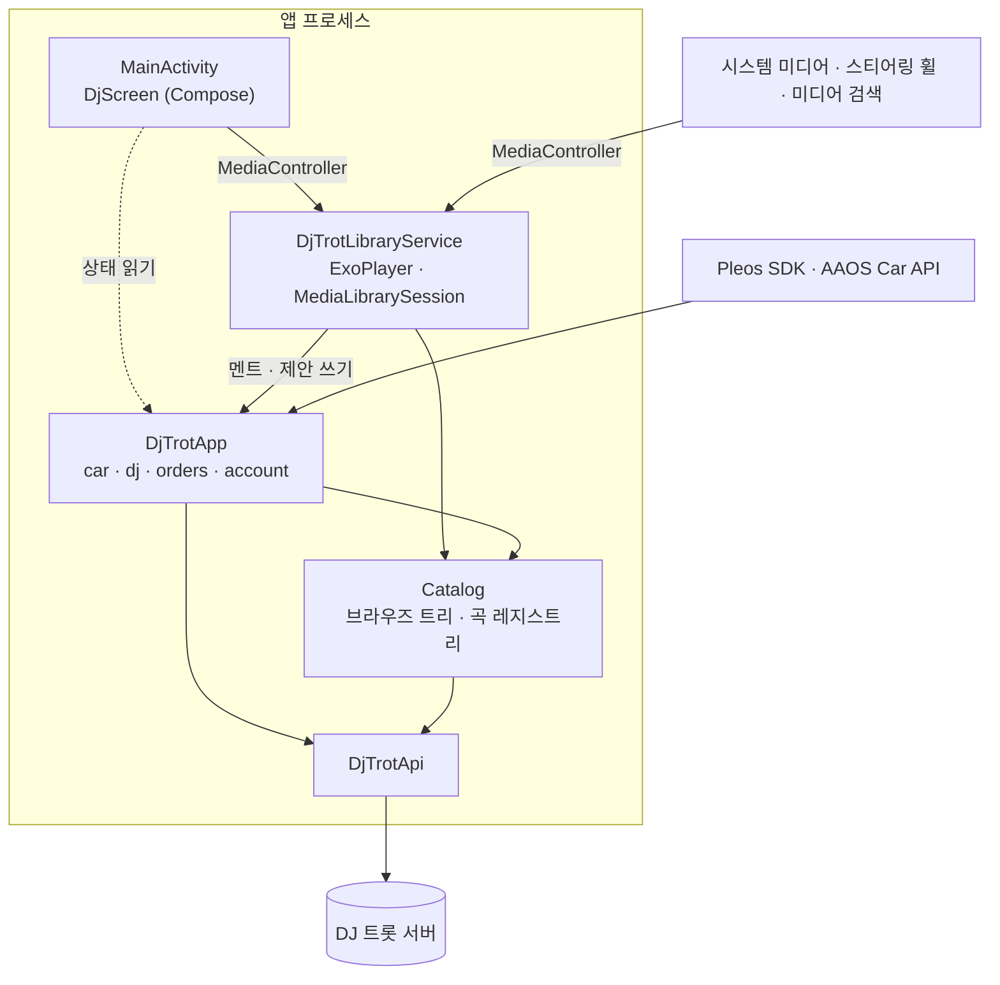
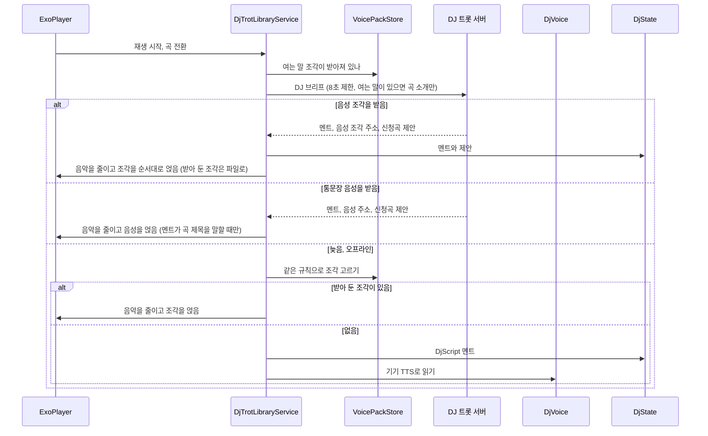
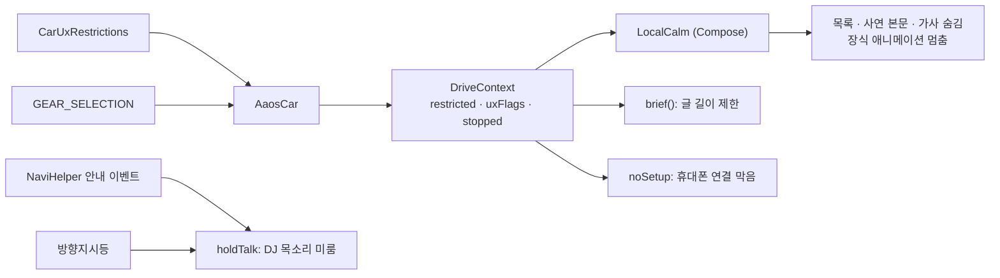

# 구조

DJ 트롯 차량 앱이 어떻게 짜여 있고 왜 그렇게 짰는지 정리합니다. 무엇을 하는 앱인지는 [README](../README.md)를 먼저 봐 주세요.

## 한눈에

모듈은 `:app` 하나이고 프로세스도 하나입니다. 화면과 재생 서비스는 `DjTrotApp`이 만든 객체를 함께 씁니다.

| 패키지 | 맡은 일 |
| --- | --- |
| `api/` | 서버 클라이언트(`DjTrotApi`)와 주고받는 모델(`Models.kt`) |
| `account/` | 휴대폰 페어링으로 받은 기기 자격 보관(`DeviceVault`)과 1시간 세션(`DeviceAccount`) |
| `car/` | 차량 신호를 모아 `DriveContext` 하나로(`CarSignals`, `AaosCar`) |
| `dj/` | 멘트 템플릿(`DjScript`), 음성 조각 고르기(`VoiceLines`)와 받아 둔 음성 팩(`VoicePackStore`), 기기에서 짓는 사연(`StoryBuilder`), 목소리(`DjVoice`), 노래 주문(`SongOrders`) |
| `playback/` | 재생 서비스(`DjTrotLibraryService`), 브라우즈 트리의 모양(`MediaPath`, `Shelf`), 목록·검색·큐(`Catalog`) |
| `ui/` | 화면. 무대(`DjScreen`), 목록(`Shelf`), 트롯 제작실(`CreateStudio`), 휴대폰 연결(`ConnectActivity`), 공통 부품과 테마 |

## 상태는 어디에 있나

| 상태 | 주인 | 쓰는 쪽 | 읽는 쪽 |
| --- | --- | --- | --- |
| 차량 신호 `StateFlow<DriveContext>` | `CarSignals` | Pleos SDK와 AAOS 콜백 | 화면, 서비스(멘트 재료) |
| DJ 상태 `MutableStateFlow<DjState>` | `DjTrotApp.dj` | 서비스(멘트, 신청곡 제안, 재생 문제) | 화면 |
| 노래 주문 `current`, 토큰 `tokens` | `SongOrders` | 화면의 "노래 만들기" | 화면, 서비스(`ready`를 받아 큐에 넣음) |
| 연결 상태 `connection` | `DeviceAccount` | 페어링, 세션 갱신, 401 | 화면, `Catalog`(내 노래 폴더) |
| 재생 상태 | 서비스의 ExoPlayer | 화면·스티어링 휠·음성의 MediaController | 화면(`rememberPlayerUi`) |

차량 신호는 화면(보이는 동안)과 재생 서비스(사는 동안)가 `car.hold()`로 잡습니다. 먼저 잡는 쪽이 듣기를 켜고, 둘 다 놓으면 10초 뒤에 리스너를 풀고 SDK 연결을 놓습니다. 쓰지 않는 앱이 차량 서비스에 붙어 타이머를 돌리지 않게 하려는 것입니다. 곡 정보는 `MediaItem`의 `MediaMetadata.extras`(`djtrot.*` 키)에 실려 서비스와 화면, 시스템 미디어가 같은 값을 봅니다.

## 곡이 바뀔 때

- 멘트는 곡이 실제로 울리기 시작할 때 한 번만 냅니다. 오래 멈췄다 같은 곡을 이어 틀면 신청곡 제안만 새로 받습니다.
- DJ의 말은 조각으로 이어 붙습니다. 여는 말(시간대, 날씨, 길 위의 장면), 남은 시간, 곡 소개 순서입니다. 조각 ID와 고르는 규칙은 서버와의 계약이고 `dj/VoiceLines`에 있습니다. 같은 곡은 같은 조각이 나옵니다.
- 길게 말하는 것은 재생 목록의 첫 곡과 그 뒤 세 곡마다입니다. 사이의 곡과 어린이보호구역에서는 곡 소개만 합니다.
- `dj/VoicePackStore`가 앱을 켤 때와 곡을 소개할 때 서버의 음성 팩 목록을 확인해(다 받았으면 한 시간에 한 번) 조각을 앱 내부 저장소에 받아 둡니다. 받아 둔 조각이 있으면 서버가 닿지 않아도, 출발·도착·경유 인사도 같은 DJ 목소리로 말합니다. 받는 중에 끊긴 조각은 쓰지 않고 다음에 이어 받습니다.
- 여는 말을 받아 둔 조각으로 낼 수 있으면 서버에는 곡 소개만 청합니다. 즐겨찾기의 집·회사나 동승자처럼 차만 아는 것으로 고른 말("집까지…", "함께 타신 분…")을 쓰려는 것입니다. 이 값들은 서버로 가지 않습니다.
- 서버에는 날씨(비, 안개)와 길 위의 장면 하나(휴게소, 터널, 톨게이트, 정체, 사고, 오래 달림, 충전, 크루즈, 발길 닿는 대로)를 보냅니다. 분위기 장면(충전, 크루즈, 발길 닿는 대로)은 곡의 절반에만 보내 같은 말이 이어지지 않게 합니다.
- 연결된 계정이면 브리프에 이미 가진 세션 토큰을 붙입니다. 서버가 주인을 확인한 신청곡만 제목으로 소개합니다. 토큰을 새로 받느라 멘트를 늦추지는 않습니다.
- DJ의 목소리는 서버가 만든 음성이 먼저입니다. 서버가 음성을 주지 못하면(팩이 꺼짐, 그날의 합성 상한) 받아 둔 음성 팩으로 말하고, 통문장 음성이 곡 제목을 말하지 않으면 받아 둔 곡 소개 조각을 뒤에 이어 같은 목소리로 끝냅니다. 그 음성이 하나도 없을 때만 기기 TTS가 읽습니다. 조각을 틀지 못하면 같은 글을 기기 TTS가 읽습니다.
- 새로 더한 장면의 조각을 아직 받지 못했으면 장면 없이 시간대·날씨 인사로 고릅니다. 서버도 같은 식으로 고릅니다.
- 음성 맨 앞에는 0.18초의 묵음을 둡니다. 출력 경로가 열리는 사이 첫 음절이 잘리지 않게 하려는 것입니다.
- 음원을 받지 못한 곡은 건너뛰고, 세 곡 연속 실패하면 멈추고 화면에 알립니다.

## 노래 주문

`SongOrders`가 앱 범위 코루틴에서 `POST /songs`를 보내고 3초마다 상태를 확인합니다. 서버가 알려 주는 단계(작사·작곡·마무리)와 제목·가사 몇 줄은 트롯생성 칸(`ui/CreateStudio`)이 사연 신청 → 제작 중계 → 첫 방송 세 막으로 보여 줍니다. 서버 설정이 노래 만들기를 닫아 두면 만들기 버튼을 잠급니다. 서버가 시연 모드를 켜 두면 휴대폰을 연결하지 않은 차도 기기에 만든 손님 ID(`account/SongAccess`)로 생성권 없이 만들고, 그 ID로 만든 곡을 다시 읽습니다. 손님 ID에는 개인 정보가 없습니다. 응답을 받지 못하고 실패한 주문을 다시 누르면 같은 `requestKey`를 보내서, 첫 요청이 서버에 닿았더라도 한 곡만 만들어집니다. 완성되면 `Catalog.register()`로 "내 드라이브 노래"에 넣고 `ready`로 내보냅니다. 서비스가 그 곡을 지금 곡 다음에 넣고 DJ가 알립니다. 화면을 닫아도 주문은 끝까지 지켜봅니다. 전체 흐름은 README의 순서도에 있습니다.

## 주행 중 제한

`DjScreen`은 `!stopped || restricted`이면 주행 중으로 보고 `LocalCalm`을 켭니다. 아래 부품은 이 값만 보고 스스로 줄어듭니다. 새 부품도 같은 값을 따라야 합니다. 판단 규칙(`DriveContext`)은 안드로이드에 의존하지 않아 JVM 테스트로 검사합니다.

DJ 목소리는 화면과 따로 미룹니다. 내비가 300m 안의 회전, 주의 구간, 단속 카메라를 알리거나 방향지시등이 켜지면 `holdTalk`가 참이 됩니다. 멘트는 화면에 먼저 뜨고, 목소리는 풀리고 1.5초 쉰 뒤에 나옵니다. 15초를 넘게 기다리면 읽지 않습니다. 기기 TTS로 읽을 때는 음악을 0.3초에 걸쳐 먼저 줄이고 0.4초 뒤에 입을 뗍니다.

## 설계 결정

- **브라우즈 트리 하나를 화면과 미디어 센터가 함께 씀.** AAOS 미디어 센터는 루트 바로 아래 폴더를 탭으로 그립니다. 그 네 폴더(`Shelf`)를 앱 화면의 탭으로도 써서, 어디서 보든 같은 목록이 같은 순서로 나옵니다. 곡 ID는 목록과 상관없이 `song:{id}` 하나이고, 어느 목록에서 골랐는지는 큐로 전합니다. 화면은 보이는 목록을 통째로 보내고, 곡 하나만 보내는 컨트롤러에는 마지막으로 보여 준 목록을 이어 줍니다.

- **DI 프레임워크 없이 `Application`의 lazy 객체로.** 객체 그래프가 한 단계라 프레임워크가 주는 이득보다 비용이 큽니다. 테스트하는 규칙은 순수 함수와 데이터 클래스로 빼 둡니다.
- **재생과 DJ를 서비스에 둠.** 화면이 닫혀도, 다른 앱이 앞에 있어도 곡 소개와 완성 알림이 나와야 합니다. 스티어링 휠과 시스템 미디어도 같은 세션에 붙습니다.
- **쓰지 않으면 내려놓음.** 노래가 나오지 않은 채 5분(끝났거나 틀기 전이면 1분)이 지나면 서비스가 재생기를 멈춰 오디오 포커스를 돌려주고 Started 상태를 풉니다. 화면도 떠나 있으면 서비스가 사라지고 프로세스는 cached 상태가 됩니다. 재생 목록과 위치는 재생기에 남아 다시 누르면 준비부터 이어집니다.
- **서버 없이도 이어지게.** DJ 멘트와 신청곡 사연은 서버가 늦거나 닿지 않으면 기기 규칙으로 만듭니다. 운전 중에 빈 화면이나 침묵을 만들지 않으려는 것입니다.
- **보낼 때는 엄격하게.** 서버는 모르는 키가 든 요청을 거절합니다. 앱은 null인 키를 보내지 않고(`explicitNulls = false`), 받을 때는 모르는 키를 무시합니다. 모양은 `ContractTest`가 지킵니다.
- **기준 창에 맞춰 비례 조정.** Pleos 앱 창은 두 칸(1682×1210dp)과 한 칸(그 절반 폭) 두 가지입니다. 각 기준 크기로 그린 뒤 `LocalDensity`로 실제 창에 맞춥니다. 두 칸을 그대로 줄이지 않고 한 칸에서는 탭 배치로 다시 짭니다.

## 테스트의 경계

| 대상 | 방법 |
| --- | --- |
| 서버 계약, 주행 판단, 멘트·사연, 가사 시각, 표지 고르기 | JVM 단위 테스트(`app/src/test`) |
| 재생 서비스, Pleos SDK, 창 크기, 주행 중 화면 | Pleos Connect Emulator에서 확인 |
| 서버 쪽 동작(노래 만들기 흐름) | 목 서버 `tools/mock_djtrot.py --fake-songs` |
| 에뮬레이터가 주지 않는 차량·내비 신호, 말로 넣는 사연 | `tools/trigger.py`로 디버그 빌드에 덧씌워 확인 |
